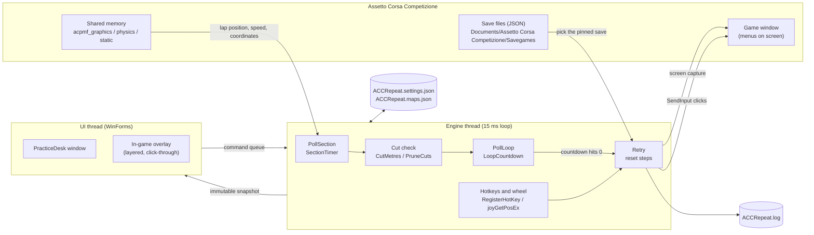

# How ACC Repeat works

ACC Repeat is a single Windows executable that sits beside Assetto Corsa Competizione (ACC). It reads ACC's live telemetry to time a stretch of track, and it resets you to a save by driving ACC's own menus with synthetic mouse and keyboard input, checking each menu on screen before it clicks. This document explains the moving parts and the tradeoffs behind them.

## Threads and ownership

The app runs two threads. The **engine thread** owns everything that touches ACC or the settings: it polls telemetry, the wheel and hotkeys every 15 ms and runs resets. The **UI thread** runs the WinForms window and the overlay. The UI never mutates engine state directly. It enqueues commands into a `ConcurrentQueue<Action>` that the engine drains each tick, and it renders from a `DeskSnapshot` that the engine publishes as a fresh immutable object (`DesktopSession.cs`). That one rule removes most locking: each piece of state has exactly one thread that writes it.

The console build (`Build.ps1 -Console`) runs the same engine loop without the window, which made it a cheap way to debug the engine early on.

## Reading the game's live data

ACC publishes telemetry through three named memory-mapped files: `Local\acpmf_graphics`, `Local\acpmf_physics` and `Local\acpmf_static`. `ReadTelemetry` (`SectionTiming.cs`) opens each page read-only and reads a handful of fields at fixed byte offsets from Kunos's shared memory layout (v1.8.12): game status, session type, normalized lap position (0 to 1), distance, speed, track name, and the player car's world coordinates.

Every read is validated before it's used. The frame is discarded unless ACC is live in a solo practice session and the values are in range. The page can disappear at any moment when ACC closes, so I/O exceptions mean "no frame" rather than a crash.

## Timing a section

A section is two lap positions, `Start` and `Finish`. Telemetry arrives at 40 Hz at best, so the car is almost never exactly on a line. `SectionTimer.Observe` looks at consecutive frames, and when a line falls between them it **linearly interpolates** the crossing time and speed. This gives millisecond-level times from 25 ms samples. Positions wrap at 1.0, so a section can span the start/finish line.

The timer is defensive about discontinuities. A frame is rejected and the run abandoned if time goes backwards, the gap is over 350 ms, or the car moved further than its speed allows (a teleport after loading a save). A section crossed in one jump therefore never counts as a run.

## Spotting shortcut runs

ACC marks every lap invalid as soon as a save loads, so its own track-limits verdict is useless here. Instead, the timer also integrates the **distance actually driven** from speed and time (`(v1 + v2) / 2 × dt`). ACC's own distance and lap position follow the track's centre line, so they don't shrink when you cut a chicane, but distance from speed does.

`CutMetres` compares a run's driven distance with the **median** of recent runs. If it's shorter by more than 1 % or 4 m, whichever is larger, the run is a cut. The median keeps one odd run from moving the baseline. Running wide makes a run *longer*, so it's deliberately not flagged. Because the first runs on new lines have nothing to compare against, `PruneCuts` re-checks the stored history once three measured runs exist and removes cuts that slipped in, including a cut personal best.

## Resetting by driving the menus

ACC has no API for loading a save, so a reset does what a person would: quit the session, open **Saved Games**, select **Play** on the right row, then select **Drive**. `Retry` and `ExitPracticeForRetry` (`RepeatCorner.cs`) run this as a sequence of named steps. Every step waits until the expected menu is recognized before clicking, with a timeout. A reset never clicks blind, and when something goes wrong it stops and reports which step failed.

Choosing the save is file-based. ACC writes each save as JSON in `Documents\Assetto Corsa Competizione\Savegames`. A pin is identified by slot, creation date and track, so a newer save in a different slot doesn't displace it, and a save that ACC overwrote in the same slot is detected rather than loaded by mistake (`SelectSave`).

## Recognizing menus across resolutions

Menu detection works on the pixels, not on OCR. Each menu label has a hand-made **signature**: a small mask where each pixel is "bright stroke", "dark background" or "ignore", stored as Base64 (`MenuSignatures.cs`, `WideMenuSignatures.cs`). To check a menu, the tool captures that region of the ACC window, scales it to the signature's reference size, thresholds it to bright and dark, and requires about 70 % of the strokes and background to match.

ACC lays its menus out differently at 16:9 and 16:10, so there are two reference layouts. `MenuLayout.Select` picks one from the window's client size, and scales every button position and capture region from the reference width. ACC also shifts some labels by a pixel at certain resolutions, so if the exact match fails, the matcher retries at small offsets and allows a one-pixel tolerance in the strokes, while still requiring the dark outline to match. That keeps a blank or solid-bright region from passing as a label.

## Placing the timing lines

There are two ways to set the lines:

- **From the car.** Ctrl+Shift+K and Ctrl+Shift+L record the car's current lap position from telemetry.
- **On a map.** The map dialog shows the circuit and turns a click into a lap position. A track map is 1,000 points, one per 0.1 % of the lap, in ACC world coordinates. `TrackMapView.Nearest` projects the click onto the nearest track segment and interpolates the lap position along it.

Maps come from three sources, in priority order: one the user imported (a Race Element `.bin`), one of the 25 bundled maps, or one recorded by driving a lap, where each telemetry frame fills the slot for its lap position. The amber **Load** marker comes from the save file itself, which stores the car's spline position.

## Persistence and diagnostics

Settings, pins, timing lines and run history are one JSON file beside the executable (`ACCRepeat.settings.json`), written through `JavaScriptSerializer`. New fields are optional, so older files upgrade on load without a migration step. Recorded and imported maps go in `ACCRepeat.maps.json`.

Each reset step, the ACC window size, every menu recognized (with how long it took) and any failure are appended to `ACCRepeat.log` beside the executable. The log rotates at 1 MB and keeps one previous file. When someone reports "the reset stopped", the log shows which step, which menu and how long it waited.

## Testing

The xUnit project in `tests/` compiles the app's sources directly and covers the logic that doesn't need ACC running: save selection and pin renames, crossing interpolation and lap wrap, teleport and interruption handling, driven distance, cut detection and pruning, run history and PB promotion, the loop countdown, track map picking and `.bin` import, all bundled maps, and menu layout geometry and signature matching. CI runs the build and the tests on `windows-latest` for every push and pull request.

What the tests can't cover is the conversation with the real game: screen capture, synthetic input and live shared memory. Those are checked by hand in ACC.

## Tradeoffs and limitations

- **Driven distance instead of ACC's track limits.** ACC invalidates every lap after a save loads, so there is no usable track-limits signal. The distance-based check only catches shortcuts that shorten the run, such as straight-lining a chicane. Running wide over a kerb isn't flagged, and the first runs on new lines can't be judged until there are runs to compare against.
- **Pixel signatures instead of OCR or an API.** ACC has no automation API, and OCR would add a large dependency and still need per-layout tuning. Signatures are small and fast, but they're tied to the **English menus of ACC 1.10.4** and to the four client sizes that have reference layouts (1920 × 1080, 2560 × 1440, 1440 × 900, 2880 × 1800). Each new layout means capturing new signatures by hand.
- **Windowed or borderless only for the overlay.** The overlay is a layered, click-through window above ACC. Exclusive fullscreen doesn't allow other windows on top, so the overlay can't appear there.
- **Synthetic input needs a clear view.** Clicks go to screen coordinates, so another window covering ACC's **Play** button would receive the click. The tool checks which window is under the button before clicking and stops instead of clicking the wrong thing.
- **.NET Framework 4.x and `csc`.** The app builds with the C# compiler that ships with Windows, so anyone can build it without installing an SDK. The cost is C# 5 syntax in the app and `JavaScriptSerializer` instead of a modern JSON library. Moving to .NET 8 is possible but would need careful retesting of the overlay, DPI handling and `System.Speech`.
- **Global static state.** The engine is a `static partial class` whose state (`game`, `stage`, `reloadInProgress`, `settings`, the loop fields) lives in static fields. It works because one thread owns that state, but it means tests share state and must run one at a time, and the reset logic can't be tested without a real game window. Splitting this into objects such as a game connection, a reset controller and a settings store, passed in where they're needed, is the main refactoring still to do.
