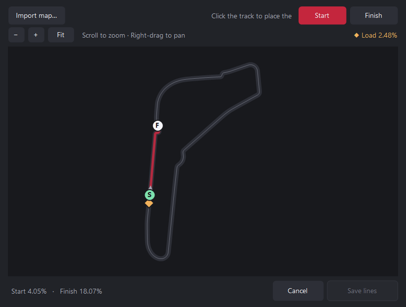

# ACC Repeat

[](https://github.com/KadyrovAkram/acc-repeat/actions/workflows/ci.yml) [](LICENSE)

Repeat any stretch of track you choose in Assetto Corsa Competizione (ACC) without driving a full lap between attempts. Practice a braking zone, a single corner, a sequence of corners, or a whole sector. It works like iRacing's Active Reset: save in solo Free Practice just before the section, then press a wheel button to reset to that save and go again. ACC Repeat times the section between a start line and a finish line you set, shows your delta to your personal best (PB), and can reset you automatically after each run.


## Quick start

Download the Windows ZIP for the [latest release](https://github.com/KadyrovAkram/acc-repeat/releases/latest) (currently **v0.2.0**), extract it, and keep the `Maps` folder beside `ACC Repeat.exe`. To try changes that haven't been released yet, [build the Windows app from `main`](#build-on-windows).

If you're upgrading from v0.1.0, rename `RepeatCorner.settings.json` to `ACCRepeat.settings.json` and place it next to `ACC Repeat.exe` to keep your pins, timing lines and run history. If you imported or recorded track maps, also rename `RepeatCorner.maps.json` to `ACCRepeat.maps.json`.

1. Launch `ACC Repeat.exe` and leave its window open. You can minimize it while driving.
2. In ACC, start **Single Player → Free Practice** and drive to the stretch you want to practice.
3. A few seconds before the section begins, open the pause menu and select **Save**. Save at speed so you get a flying start when you return.
4. Drive the section. With ACC focused, press **Ctrl+Shift+J** to reset: ACC Repeat quits the current run, loads the selected save, and selects **Drive**.

By default, a reset uses the newest entry in **Saved Games**, which must be a Free Practice save. Save earlier on the approach if you need more room to settle the car and get up to speed after loading.

Keep floating windows clear of ACC's menu buttons. If a window covers **Play** after **Saved Games** opens, move it away and press **Ctrl+Shift+J** again with ACC focused.

## Bind a wheel button

Connect your wheel or button box, select **Bind wheel**, then press the button you want to use within 15 seconds. Pick a spare button. With ACC focused, press it once to reset. The app shows the bound button. Select **Clear** to remove the binding.

The tool reads the first 32 buttons that the device exposes through the Windows joystick API. If Windows changes the device slot after reconnecting the wheel, bind it again. **Ctrl+Shift+J** is also available as the keyboard shortcut.

## Pin a save

Select **Pin a save**, choose an ACC save, and give it a name such as **Monza Rettifilo** or **Spa Sector 2**. Creating another ACC save leaves the pin on its original save. Use **Active save** to switch between your pins or return to **Latest save**.

To rename a pin, select **Pin a save**, choose the same ACC save, and enter the new name. The pin keeps its timing lines, PB, and recent runs.

Pins refer to ACC's original saves. Keep the pinned save among the first five rows in **Saved Games**. If ACC deletes or overwrites it, select another pin or create a new one. The tool stores its settings beside the executable in `ACCRepeat.settings.json`.

## Time a section

1. Save **before** the place where you want timing to start. Select the pin first if you want the timing lines attached to it.
2. With ACC focused, press **Ctrl+Shift+K** to mark the start line, such as just before your first braking point, and **Ctrl+Shift+L** to mark the finish line, such as after the last corner exit. Set the finish less than half a lap ahead of the start. You can mark either line while paused on track.
3. Reset and cross both lines in order. The app shows the section time, your entry and exit speeds, and where the lines are on the lap.

Timing lines belong to the active pin or, in latest-save mode, the current track, and are saved with it. You only need to set them once per pin. Marking a new start line clears that section's previous finish line.

### Place timing lines on the track map

Instead of pressing the shortcuts at the right moment, select **Place on map…** in the app. Choose **Start** or **Finish**, then click the track where you want that line. The highlighted stretch between them is the timed section. Select **Save lines** to use them. Moving either line starts a new run history.

Scroll over a corner to zoom toward it, or use **+** and **−**. While zoomed in, drag with the right mouse button to move around. **Fit** shows the whole circuit again.

The amber **Load** diamond shows where your selected save places the car on the circuit. Its percentage is the saved position along the lap. Place the start line far enough ahead to give yourself a run-up after loading.



ACC Repeat includes 25 ACC maps and loads the one for your selected save automatically. Nürburgring GP and Nürburgring 24h each have their own map. The DLC is required to drive DLC layouts in ACC. See the [map credits and license](Maps/README.md).

Use **Import map…** to load a custom Race Element ACC `.bin` for the selected track, keeping its original filename. If you have no map for that track, you can draw one by driving a lap with ACC focused and ACC Repeat open. Imported and recorded maps are saved in `ACCRepeat.maps.json` beside the executable.

### Review your runs

**Last attempt** shows your section time and entry and exit speeds. The delta to your previous PB is green (negative) when you go quicker and amber (positive) when you go slower.

**Recent attempts** lists your last five runs, newest first. The **DELTA** column shows each run's delta to your current PB. A longer bar means a bigger delta, and the **PB** badge marks a run that matches your best. Your PB stays saved after it drops out of the recent list.

History is stored with the timing lines in `ACCRepeat.settings.json`. Moving either line starts a new history for that section.

### Experimental track limits

To try the Brands Hatch pilot, run `python .\tools\install-brands-hatch-limits.py` from the repository root, then start ACC Repeat. The installer converts the pinned [RaceIQ Brands Hatch map](https://github.com/SpeedHQ/RaceIQ/blob/930f65425e9a0c271a6612107deec2f3fec01b3d/shared/data/tracks/acc/brands-hatch.track.svg) into `bin\TrackLimits\brands_hatch.csv`. Restart ACC Repeat after adding the map.

With an experimental track boundary file installed, ACC Repeat checks the four tyre contact positions against the mapped edges. It rejects a run if all four contact points stay more than 0.25 m outside for at least 0.12 s. The check starts fresh at the timing line regardless of the saved lap’s validity.

This pilot uses geometric boundaries. ACC also applies track-specific rules, surface exceptions, and other invalidation conditions. For tracks without boundary data, the app records section times without a track-limits verdict.

### Remove a run

To remove a run you don't want counted, hover over it in **Recent attempts** and select the **×** at the end of the row, then confirm. If your PB has dropped out of the last five runs, it gets its own **Best** row so you can remove it too. When you remove your PB, the quickest run left in the list becomes your PB. Removing a run can't be undone. In the console version, use `history remove <1-5>` or `history remove best`.

### Run a hands-free loop

With both timing lines set, use **−** and **+** under **Countdown** to choose a delay from 1 to 30 seconds. The default is 3 seconds. Select **Arm loop**, return to ACC, and reset once to start from the selected save. After each timed finish, the tool reads out your time, shows the countdown, and resets you to that save, so you can drill the same section run after run. The voice reads the final three seconds.

You can switch windows with Alt+Tab or your touchpad to check results. A pending countdown pauses while ACC is out of focus and resumes with the remaining time when you return to live driving. If ACC paused itself, select **Drive** to continue the countdown. A reset already in progress waits for ACC to regain focus, then checks the expected menu before continuing.

Press **F9** in ACC or select **Disarm loop** to turn the loop off. Press your wheel button or **Ctrl+Shift+J** to reset early and keep looping. The loop starts off each time you launch the tool. Switching saves, moving the timing lines, or leaving the practice session turns it off during a countdown.

## In-game overlay

During Free Practice in windowed or borderless mode, the overlay shows your live section time between the timing lines. After the finish it shows your result and delta to your PB. During an auto-reset countdown it also shows the seconds remaining.


Use **In-game overlay** in the app to choose **Top centre**, **Top left**, **Top right**, **Bottom centre**, or **Off**. The default position is **Top centre**. The panel lets clicks pass through to ACC and hides on the main menu, during a reset, and when ACC loses focus.

If the panel is missing in fullscreen, open **Options → Video** in ACC, set **Fullscreen** to **Disabled**, and select **Apply**. Choose a supported resolution that fits on your desktop if needed. **Alt+Enter** can also switch ACC to windowed mode for a quick check.

## Screenshots

Use **Save** in the Free Practice pause menu to create a save to reset to.


On reset, the tool selects **Play** on the save's row in **Saved Games** and then selects **Drive** when the session loads.


## Build on Windows

Run the following from the repository root in PowerShell. The build uses the 64-bit .NET Framework 4.x compiler installed with Windows.

```powershell
.\Build.ps1
& '.\bin\ACC Repeat.exe'
```

Run `.\Build.ps1 -Test` to build the app and run the xUnit tests in `tests/`, which cover save selection, wheel button decoding, section timing, tyre-based track limits, attempt history, the loop countdown, track maps, and menu layout without opening ACC. The tests need the [.NET 8 SDK](https://dotnet.microsoft.com/download/dotnet/8.0); the app itself doesn't. CI runs the same command on every push and pull request. Run `.\Build.ps1 -Console` to build the command-line version. It uses the same settings file and shortcuts. Type `help` in the console to see its commands.

## How it works

See [ARCHITECTURE.md](ARCHITECTURE.md) for how the tool reads ACC's shared memory, recognizes menus at different resolutions, times sections and checks experimental track limits, and for the tradeoffs and limitations behind those choices.

## Compatibility

The tool uses English menus from ACC 1.10.4 and detects the ACC window's client size on each reset.

| Aspect ratio | Supported client sizes |
| --- | --- |
| 16:9 | 1920 × 1080 (1080p), 2560 × 1440 (1440p) |
| 16:10 | 1440 × 900, 2880 × 1800 |

If you change resolution during a reset, start a new reset from the practice session once ACC has finished applying the change.

## Troubleshooting

- Hold **F9** during a reset to cancel it. Close the ACC Repeat window to stop the tool.
- If the status says **Switch back to ACC to continue**, return to ACC to resume the reset. If it stops because it could not confirm a menu, load the save manually and try again.
- If the tool stops while selecting a menu button, give it a moment to position the cursor during that step. The message at the bottom reports where it stopped.
- Each reset step, the menus it recognized, and any failure are written to `ACCRepeat.log` beside `ACC Repeat.exe`. Attach it when you report a problem.

## License

ACC Repeat is released under the [MIT License](LICENSE). The bundled track maps are covered by their own [GPLv3 license](Maps/LICENSE.txt).
