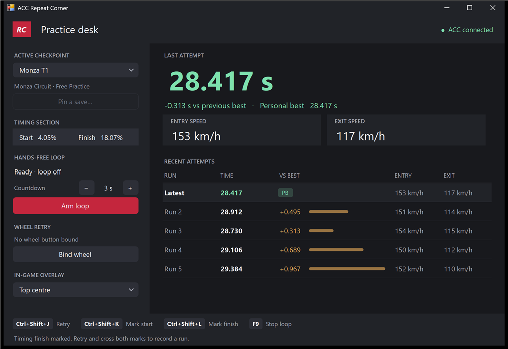
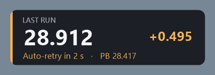
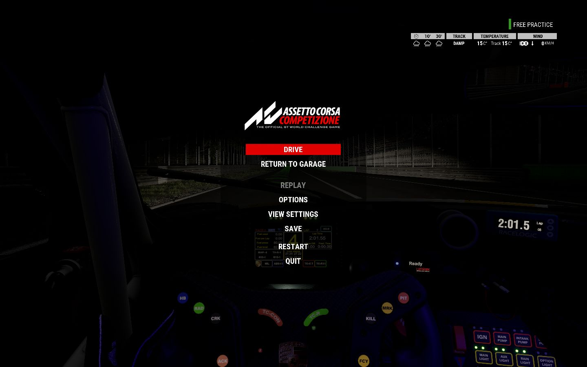
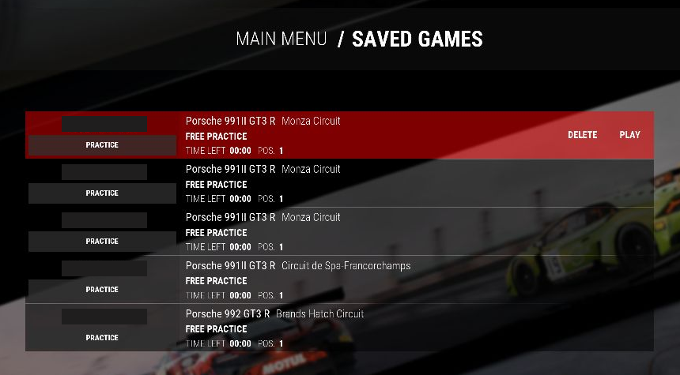

# ACC Repeat Corner

Repeat a chosen stretch of track in Assetto Corsa Competizione without driving a full lap between attempts. Practice a braking zone, a sequence of corners, or a sector. Save your approach in solo Free Practice, then use a shortcut to reload the checkpoint and drive the section again.



## Quick start

Download the Windows ZIP from [GitHub Releases](https://github.com/KadyrovAkram/acc-repeat-corner/releases), extract it, and keep the `Maps` folder beside the executable.

1. Launch `ACC Repeat Corner.exe` and leave the Practice desk open. You can minimize it while driving.
2. In ACC, start **Single Player → Free Practice** and drive to your chosen section.
3. A few seconds before the section begins, open the pause menu and select **Save**. Save while rolling so you have a run-up when you return.
4. Drive the section. With ACC focused, press **Ctrl+Shift+J** to quit the current run, reload the selected save, and select **Drive**.

By default, Retry uses the newest entry in **Saved Games**, which must be a Free Practice save. Save earlier on the approach if you need more room to settle the car after loading.

Keep floating windows clear of ACC's menu buttons. If a window covers **Play** after **Saved Games** opens, move it away and press **Ctrl+Shift+J** again with ACC focused.

## Bind a wheel button

Connect your wheel, select **Bind wheel**, then press the wheel button you want to use within 15 seconds. Pick a spare button. With ACC focused, press it once to retry. The Practice desk shows the bound button. Select **Clear** to remove the binding.

The tool reads the first 32 buttons that the device exposes through the Windows joystick API. If Windows changes the device slot after reconnecting the wheel, bind it again. **Ctrl+Shift+J** is also available as the keyboard shortcut.

## Pin a checkpoint

Select **Pin a save**, choose an ACC save, and give it a name such as **Monza Sector 1**. Creating another ACC save leaves the pin on its original save. Use **Active checkpoint** to switch between your pins or return to **Latest save**.

To rename a checkpoint, select **Pin a save**, choose the same ACC save, and enter the new name. The checkpoint keeps its timing markers, personal best, and recent runs.

Pins refer to ACC's original saves. Keep the chosen save among the first five rows in **Saved Games**. If ACC deletes or overwrites it, select another pin or create a new one. The tool stores its settings beside the executable in `RepeatCorner.settings.json`.

## Time a section

1. Save a rolling checkpoint **before** the place where you want timing to start. Select the pin first if you want the markers attached to it.
2. With ACC focused, press **Ctrl+Shift+K** at the start of the stretch and **Ctrl+Shift+L** where you want the timer to stop. Set the finish less than half a lap ahead of the start. You can mark either point while paused on track.
3. Retry and cross both marks in order. The Practice desk shows the section time, speeds at both marks, and saved marker positions.

Markers belong to the active pin or, in latest-save mode, the current track, and are saved with it. You only need to place them once per checkpoint. Marking a new start clears that drill's previous finish.

### Place markers on the track map

Instead of pressing the shortcuts at the right moment, select **Place on map…** on the Practice desk. Choose **Start** or **Finish**, then click the track where you want that marker. The highlighted stretch between them is the timed section. Select **Save markers** to use them. Moving either marker starts a new run history.

Scroll over a corner to zoom toward it, or use **+** and **−**. While zoomed in, drag with the right mouse button to move around. **Fit** shows the whole circuit again.

Repeat Corner includes 25 ACC maps and loads the one for your selected checkpoint automatically. Nürburgring GP and Nürburgring 24h each have their own map. The DLC is required to drive DLC layouts in ACC. See the [map credits and license](Maps/README.md).

Use **Import map…** to load a custom Race Element ACC `.bin` for the selected track, keeping its original filename. If you have no map for that track, you can draw one by driving a lap with ACC focused and Repeat Corner open. Imported and recorded maps are saved in `RepeatCorner.maps.json` beside the executable.

### Review your runs

**Last attempt** shows your section time and entry and exit speeds. New runs include the gap to your previous personal best. A negative gap means you went quicker. A positive gap means you were slower.

**Recent attempts** lists your last five runs, newest first. The **VS BEST** column compares each run with your current personal best. A longer bar means a bigger gap, and the **PB** badge marks a run that matches your best. Your best stays saved after it drops out of the recent list.

History is stored with the timing markers in `RepeatCorner.settings.json`. Changing either marker starts a new history for that section.

### Cut runs aren't recorded

The tool measures how far the car actually drove between the markers. If a run is clearly shorter than your recent runs through the section (more than 1% of the distance, or 4 m, whichever is larger), it's treated as a cut. The run isn't added to your history or personal best. The Practice desk says by how much it was short, the in-game overlay shows **Cut · not counted** with the run's time until your next run, and in a loop the voice says "Cut. Not counted." before retrying.

ACC marks every lap invalid as soon as a save loads, so the tool can't use ACC's own track-limits verdict. The check only catches shortcuts, such as straight-lining a chicane. Running wide isn't flagged, because it only makes the run slower. The first runs on a new pair of markers have nothing to compare against, so they're always recorded. Once three runs have a measured distance, the tool applies the same check to the runs already in your history, including your personal best, and removes the cuts. It does this after each run and when it starts.

### Remove a run

To remove a run you don't want counted, hover over it in **Recent attempts** and select the **×** at the end of the row, then confirm. If your personal best has dropped out of the last five runs, it gets its own **Best** row so you can remove it too. When you remove your best, the quickest run left in the list becomes your best. Removing a run can't be undone. In the console version, use `history remove <1-5>` or `history remove best`.

### Run a hands-free loop

With both timing markers set, use **−** and **+** under **Countdown** to choose a delay from 1 to 30 seconds. The default is 3 seconds. Select **Arm loop**, return to ACC, and retry once to start from the selected checkpoint. After each timed finish, the tool reads out your time, shows the countdown, and reloads that checkpoint. The voice reads the final three seconds.

You can switch windows with Alt+Tab or your touchpad to check results. A pending countdown pauses while ACC is out of focus and resumes with the remaining time when you return to live driving. If ACC paused itself, select **Drive** to continue the countdown. A reload already in progress waits for ACC to regain focus, then checks the expected menu before continuing.

Press **F9** in ACC or select **Disarm loop** to turn the loop off. Press your wheel button or **Ctrl+Shift+J** to retry early and keep looping. The loop starts off each time you launch the tool. Switching checkpoints, changing the markers, or leaving the practice session turns it off during a countdown.

## In-game overlay

In windowed or borderless mode, the overlay shows your live section time between the timing markers. After the finish it shows your result and gap to your personal best. During an auto-retry countdown it also shows the seconds remaining.



Use **In-game overlay** on the Practice desk to choose **Top centre**, **Top left**, **Top right**, **Bottom centre**, or **Off**. The default position is **Top centre**. The panel lets clicks pass through to ACC and hides during a retry and when ACC loses focus.

If the panel is missing in fullscreen, open **Options → Video** in ACC, set **Fullscreen** to **Disabled**, and select **Apply**. Choose a supported resolution that fits on your desktop if needed. **Alt+Enter** can also switch ACC to windowed mode for a quick check.

## Screenshots

Use **Save** in the Free Practice pause menu to create a checkpoint.



On retry, the tool selects **Play** on the checkpoint's row in **Saved Games** and then selects **Drive** when the session loads.



## Build on Windows

Run the following from the repository root in PowerShell. The build uses the 64-bit .NET Framework 4.x compiler installed with Windows.

```powershell
.\Build.ps1
& '.\bin\ACC Repeat Corner.exe'
```

Run `.\Build.ps1 -Test` to check checkpoint identity, wheel button decoding, timing, attempt history, the loop countdown, and menu layout without opening ACC. Run `.\Build.ps1 -Console` to build the command-line version. It uses the same settings file and shortcuts. Type `help` in the console to see its commands.

## Compatibility

The tool uses English menus from ACC 1.10.4 and detects the ACC window's client size on each retry.

| Aspect ratio | Supported client sizes |
| --- | --- |
| 16:9 | 1920 × 1080 (1080p), 2560 × 1440 (1440p) |
| 16:10 | 1440 × 900, 2880 × 1800 |

If you change resolution during a retry, start a new retry from the practice session once ACC has finished applying the change.

## Troubleshooting

- Hold **F9** during a retry to cancel it. Close the Practice desk to stop the tool.
- If the status says **Switch back to ACC to continue**, return to ACC to resume the reload. If it stops because it could not confirm a menu, load the checkpoint manually and try again.
- If the tool stops while selecting a menu button, give it a moment to position the cursor during that step. The message at the bottom reports where it stopped.
